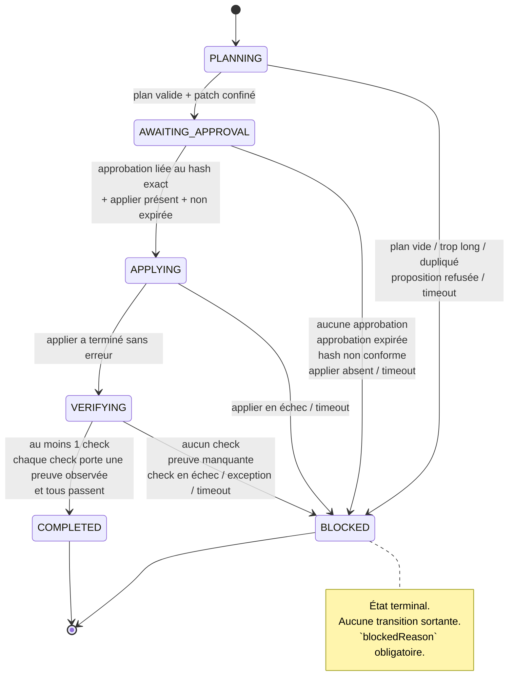

# P1 — Contrat de boucle minimale

> Statut : **contrat livré, non branché**. Le module existe et est verrouillé par
> tests, mais aucune mutation réelle n'est exécutée par défaut.
> Emplacement : `coding-engine/packages/runtime/src/loop.ts` (+ `loop.js`) et
> `coding-engine/packages/runtime/src/applier.ts` (+ `applier.js`).
> Tests : `tests/coding-engine/loop-contract.spec.ts` (41 tests) et
> `tests/coding-engine/applier-p1.spec.ts` (25 tests).

---

## 1. Pourquoi ce contrat existe

La boucle demandée en P1 est :

```
plan → proposition de patch → approbation humaine → application → vérification
```

Le risque n'est pas d'écrire la boucle, c'est de la faire mentir : un planner qui
invente un plan, un applier absent qui retourne `success: true`, une vérification
qui n'a exécuté aucun check. Le contrat inverse la charge de la preuve : **chaque
frontière échoue en `BLOCKED` si elle ne peut pas prouver ce qu'elle affirme.**

Le module ne contient **aucun** accès disque en écriture, aucun appel provider,
aucune exécution de commande. Les effets sont des ports injectés (`LoopPorts`).
En l'absence du port `applier`, l'application est refusée — c'est la garantie
qu'activer la boucle est un acte explicite, pas un défaut.

---

## 2. Diagramme d'états



Transitions autorisées, sans exception :

| Depuis | Vers | Condition |
|---|---|---|
| `PLANNING` | `AWAITING_APPROVAL` | plan non vide ≤ `maxSteps`, ids uniques, patch confiné |
| `AWAITING_APPROVAL` | `APPLYING` | approbation existante, `patchHash` identique, non expirée, `applier` fourni |
| `APPLYING` | `VERIFYING` | `applier` résolu sans lever |
| `VERIFYING` | `COMPLETED` | ≥ 1 check, chaque check a une preuve non vide, `passed === true` |
| tout état non terminal | `BLOCKED` | toute anomalie, avec `blockedReason` |

Toute autre transition lève `LoopTransitionError`. `COMPLETED` et `BLOCKED` sont
terminaux : `apply()`, `verify()` et `planAndPropose()` y sont refusés.

---

## 3. Contrats d'entrée / sortie

### 3.1 Entrées

```ts
interface LoopOptions {
  missionId: string;
  workspaceRoot: string;   // obligatoire, sinon construction refusée
  timeoutMs?: number;      // défaut 10 min
  approvalTtlMs?: number;  // défaut 5 min
  maxSteps?: number;       // défaut 12
}

interface LoopPorts {
  plan(): Promise<PlanStep[]>;                        // plan réel (ex. Planner F-04)
  propose(plan: PlanStep[]): Promise<PatchProposal>;  // patch proposé
  applier?(patch: PatchProposal): Promise<void>;      // ABSENT par défaut
  verify(): Promise<VerificationOutcome>;             // checks réellement exécutés
  now?(): number;                                     // horloge injectable
}
```

`PatchFile.content === null` signifie une suppression explicite. `propose()` ne
doit rien écrire : la proposition est une donnée, pas un effet.

### 3.2 Sorties

```ts
interface LoopSnapshot {
  version: 1;
  missionId: string;
  workspaceRoot: string;
  state: LoopState;
  createdAt: number;
  deadlineAt: number;
  plan: PlanStep[];
  patch: PatchProposal | null;
  patchHash: string | null;
  approval: Approval | null;
  verification: VerificationOutcome | null;
  blockedReason: string | null;
  events: LoopEvent[];   // { at, from, to, reason }
}
```

Le snapshot est la seule surface de persistance. Il contient l'historique complet
des transitions : un `COMPLETED` sans événements est donc détectable.

---

## 4. Invariants

1. **Aucun workspace, aucune boucle.** `workspaceRoot` vide ⇒ construction refusée.
2. **L'approbation est liée au contenu exact.** `grantApproval` exige le
   `patchHash` courant ; un hash différent est refusé. Un snapshot falsifié dont
   le patch et le hash changent ensemble est refusé à l'application
   (« non liée au patch courant »), car l'approbation conserve l'ancien hash.
3. **Une approbation expire.** `now() > approval.expiresAt` ⇒ `BLOCKED`, sans
   appel à l'applier.
4. **Pas d'applier, pas de mutation.** L'absence du port n'est jamais un succès.
5. **Le patch est confiné.** Tout chemin résolu hors de `workspaceRoot` est refusé.
   Les doublons de chemin (y compris via `../`) sont refusés.
6. **Une vérification sans preuve ne compte pas.** `results` vide ⇒ `BLOCKED` ;
   une preuve absente, non-chaîne ou blanche ⇒ `BLOCKED`.
7. **`COMPLETED` exige `passed === true` et des preuves.** Un check en échec
   suffit à bloquer.
8. **Aucun état intermédiaire n'est supposé réussi après un crash.**
   `restore()` d'un snapshot en `PLANNING`, `APPLYING` ou `VERIFYING` produit un
   `BLOCKED` avec le motif « reprise après crash ».
9. **Les états terminaux sont immuables.** Aucune opération ne repart depuis
   `COMPLETED` ou `BLOCKED`.
10. **Les workspaces sont isolés.** `createIsolatedWorkspace` crée un répertoire
    unique par mission via `mkdtemp` ; l'identifiant est normalisé (aucun
    séparateur de chemin ne subsiste).
11. **Le hash de patch est non ambigu.** Encodage à longueur préfixée et type
    explicite (`write` / `delete`) : deux patches différents ne peuvent pas
    produire la même chaîne, même si les champs contiennent `|` ou `:`.
12. **L'approbation est liée à l'état du workspace, pas seulement au patch.**
    Le contexte est capturé à la proposition (existence + SHA-256 du contenu de
    chaque fichier cible) puis re-mesuré juste avant application. Toute
    différence ⇒ `BLOCKED` « workspace modifié depuis l'approbation ».
13. **Un échec partiel est rolled back ou déclaré incomplet.** L'applier restaure
    les fichiers déjà modifiés/supprimés et supprime ceux qu'il a créés ; si le
    rollback échoue lui-même, l'erreur le dit explicitement (`rollback INCOMPLET`).

---

## 5. Preuves par frontière

| Frontière | Test | Attendu |
|---|---|---|
| Happy path | `parcourt PLANNING → … → COMPLETED` | 4 transitions, `applier` appelé 1 fois |
| Snapshot rejouable | `produit un snapshot rejouable…` | 4 événements, hash stable |
| Hash erroné | `refuse un hash qui ne correspond pas…` | `LoopTransitionError`, `approval === null` |
| Approbation incomplète | `refuse une approbation sans identifiant…` | erreur explicite |
| Double approbation | `une double approbation remplace…` | la dernière fait foi, hash inchangé |
| Approbation détournée | `refuse d'appliquer une approbation liée à un autre patch` | `BLOCKED` |
| Sans approbation | `refuse d'appliquer sans approbation` | `BLOCKED` |
| Approbation expirée | `refuse une approbation expirée` | `BLOCKED` |
| État terminal | `n'accepte aucune transition depuis un état terminal` | 3 × `LoopTransitionError` |
| Applier absent | `passe en BLOCKED quand aucun applier…` | `BLOCKED`, aucune écriture |
| Applier en échec | `passe en BLOCKED si l'applier échoue` | motif propagé |
| Zéro check | `refuse un résultat sans aucun check` | `BLOCKED` |
| Preuve blanche | `refuse un check sans preuve observée` | `BLOCKED` |
| Preuve absente | `refuse un check dont la preuve est absente` | `BLOCKED` |
| Check en échec | `refuse une vérification en échec` | `BLOCKED` |
| Vérification qui lève | `refuse une vérification qui lève une erreur` | `BLOCKED` |
| Mauvais état | `ne peut pas vérifier depuis un autre état` | `LoopTransitionError` |
| Plan vide / long / dupliqué / vide de sens | 4 tests | `BLOCKED` |
| Planification en erreur | `bloque si la planification lève` | motif propagé |
| Traversée `..` | `refuse une traversée ..` | `BLOCKED`, patch non retenu |
| Chemin absolu hors racine | `refuse un chemin absolu hors workspace` | `BLOCKED` |
| Patch vide | `refuse un patch vide` | `BLOCKED` |
| Doublon de chemin | `refuse un chemin présent plusieurs fois` | erreur |
| Timeout planification | `bloque si le délai est dépassé avant la planification` | `BLOCKED` |
| Timeout application | `bloque si le délai est dépassé avant l'application` | `BLOCKED`, applier non appelé |
| Reprise crash | `un snapshot en état PLANNING/APPLYING/VERIFYING reprend en BLOCKED` | 3 cas |
| Snapshot terminal stable | `un snapshot COMPLETED reste stable` | `COMPLETED` |
| Isolation | `crée un répertoire distinct par mission` | pas de fuite de fichier |
| Workspace absent | `refuse une boucle sans workspaceRoot` | erreur |
| Identifiant dangereux | `normalise les identifiants…` | aucun séparateur |
| Contexte manquant | `refuse d'appliquer si aucun contexte n'a été capturé` | `BLOCKED` |
| Empreinte absente | `refuse un contexte dont l'empreinte est absente` | `BLOCKED` |
| Contexte non lié | `refuse un contexte non lié au patch proposé` | `BLOCKED` |
| Workspace modifié | `refuse d'appliquer si le workspace a changé depuis l'approbation` | `BLOCKED`, applier non appelé |
| Re-capture en échec | `refuse d'appliquer si la re-capture échoue` | `BLOCKED` |

### 5.1 Applier confiné (`tests/coding-engine/applier-p1.spec.ts`)

| Frontière | Test | Attendu |
|---|---|---|
| Capture | `enregistre existence et empreinte de contenu` | pré-image exacte, aucune écriture |
| Capture hors racine | `refuse un chemin hors racine` | erreur de confinement |
| Capture + symlink | `refuse un symlink qui sort de la racine` | erreur `outside workspace root` |
| Racine incohérente | `refuse une racine incohérente avec le workspace` | erreur |
| Création | `crée un fichier et vérifie son contenu` | fichier réellement écrit |
| Modification | `modifie un fichier existant` | contenu remplacé |
| Suppression | `supprime un fichier et vérifie son absence` | fichier absent |
| Patch substitué | `refuse un patch différent de celui approuvé` | refus, fichier intact |
| Empreinte falsifiée | `refuse une empreinte de contexte falsifiée` | refus, fichier intact |
| Fichier modifié après approbation | `refuse si le fichier a été modifié…` | refus, contenu pirate préservé |
| Fichier créé après approbation | `refuse si un fichier a été créé…` | refus |
| Fichier supprimé après approbation | `refuse si un fichier a été supprimé…` | refus |
| Symlink après approbation | `refuse un symlink créé après l'approbation (TOCTOU)` | refus, hors racine intact |
| Sans `deleteFile` | `refuse si le workspace ne sait pas supprimer` | refus |
| Rollback modification | `restaure un fichier modifié quand l'écriture suivante échoue` | contenu d'origine |
| Rollback création | `supprime un fichier créé quand l'écriture suivante échoue` | fichier absent |
| Rollback suppression | `restaure un fichier supprimé quand l'écriture suivante échoue` | contenu d'origine |
| Postcondition | `refuse une écriture silencieusement sans effet` | `non conforme après écriture` |
| Hash non ambigu | `distingue des patches qui se confondraient…` | hashes différents |
| Suppression vs écriture vide | `distingue une suppression d'une écriture vide` | hashes différents |
| Ordre des fichiers | `est indépendant de l'ordre des fichiers` | hashes égaux |
| Séparateurs Windows | `normalise les séparateurs Windows` | hashes égaux |
| Intégration heureuse | `écrit réellement le fichier approuvé puis vérifie` | `COMPLETED`, fichier sur disque |
| Intégration TOCTOU | `refuse l'application si le workspace change…` | `BLOCKED`, contenu pirate intact |
| Crash APPLYING | `un crash pendant APPLYING reprend en BLOCKED…` | pas de rejeu |

---

## 6. Ce qui n'est pas encore branché (volontairement)

- **L'applier réel existe** (`applier.ts`) mais n'est branché sur **aucune route
  HTTP** : aucun appelant ne peut déclencher une application aujourd'hui.
- **Aucun appel au `Planner`** n'est fait ici : `ports.plan` reste injecté. Le
  branchement P1 consistera à passer `planner.createPlan(task)` (F-04) et
  `provider.complete` avec `tools` (F-07b).
- **Aucune persistance** : `snapshot()` renvoie un objet, l'écriture est la
  responsabilité de l'appelant (SQLite/ledger).
- **Pas de UI d'approbation** : `grantApproval` est une API, pas un écran.

Ordre des prochains chantiers : persistance du snapshot → surface d'approbation →
branchement `/api/opencode/execute`.

---

## 7. Preuves d'exécution

```
npx vitest run tests/coding-engine/loop-contract.spec.ts → 41 passed
npx vitest run tests/coding-engine/applier-p1.spec.ts → 25 passed
npm test (suite complète) → 43 fichiers, 324 tests passed
npx tsc --noEmit → 978 erreurs préexistantes dans tests/, 0 dans loop.ts / applier.ts et leurs tests
```

---

## 8. Stratégie de rollback en cas d'échec partiel

L'application d'un patch est séquentielle. Si le fichier *n* échoue, les fichiers
`0..n-1` ont déjà été mutés : ils doivent être annulés avant de rendre la main.

### 8.1 Journal d'annulation

Avant chaque mutation, l'applier enregistre une opération inverse :

| Mutation | Opération inverse |
|---|---|
| Écriture d'un fichier **créé** | supprimer le fichier |
| Écriture d'un fichier **existant** | réécrire le contenu d'origine (lu avant) |
| Suppression | réécrire le contenu d'origine (lu avant) |

Les inverses sont exécutés en **ordre inverse** (dernier appliqué, premier annulé).

### 8.2 Résultat d'un échec

- Rollback complet ⇒ erreur `applier: échec partiel (N fichier(s) appliqué(s)) ;
  rollback appliqué — cause : …`. La boucle passe en `BLOCKED`.
- Rollback partiel ⇒ erreur `… rollback INCOMPLET : <détails> — cause : …`.
  L'état du disque est alors **incertain** : l'humain doit inspecter le
  workspace avant toute reprise. Aucune reprise automatique n'est tentée.

### 8.3 Limites assumées

- **Pas de transaction atomique multi-fichiers** sur un système de fichiers
  classique. Le rollback réduit la fenêtre, il ne l'annule pas.
- **Fenêtre TOCTOU résiduelle** entre la re-vérification globale et l'écriture
  d'un fichier : réduite par le CAS par fichier (juste avant écriture), pas
  supprimée. Une suppression réelle exigerait un verrou exclusif ou un snapshot
  de volume.
- **Permissions et horodatages ne sont pas restaurés** : seuls le contenu et
  l'existence le sont. Le hash de patch ne couvre donc pas les permissions.
- **Rollback non testé sous coupure de courant** : les tests couvrent l'échec
  d'écriture, pas la perte du processus au milieu du rollback.
